# Ideas Universe Asset Tracker

**Live stock, crypto and currency prices on a 7-inch desk display.** Price alerts, portfolio tracking, world clocks, screensavers and an optional Bitcoin miner, all running on a ESP32-S3 7" capacitive Touchscreen.

This repository publishes **release builds** (firmware and update manifest) for the Asset Tracker. The full user manual follows.

## Contents

- [Part One: Overview and Setup](#part-one-overview-and-setup)
- [Part Two: Screen-by-Screen Guide](#part-two-screen-by-screen-guide)
- [Part Two (continued): Everyday Tasks and Troubleshooting](#part-two-continued-everyday-tasks-and-troubleshooting)
- [Part Three: Technical Reference](#part-three-technical-reference)
- [Appendices](#appendices)

---

## Part One: Overview and Setup

### 1. What the Asset Tracker is

The Asset Tracker is a small, standalone desk display that shows live prices for whatever mix of cryptocurrencies, stocks and currency pairs you choose to watch. There is no phone app, no pairing, no account with us and no subscription. You set it up once on its touchscreen, and from then on it keeps itself up to date over Wi-Fi.

Beyond a plain price board it has grown into a small information appliance:

- **A watchlist of up to 64 symbols**, shown eight to a page, with pages that rotate automatically or by swipe. Crypto, stocks and currency pairs can sit side by side.
- **Five chart styles** on each card: sparkline, area fill, candlestick, Heikin-Ashi, plus a **Heatmap** layout that turns the whole grid into colour-coded tiles.
- **A detail screen** for every symbol with up to seven timeframes, a moving-average overlay and an RSI indicator.
- **Your own display currency.** Every price is converted into the currency you choose (30 are supported), with the original currency shown underneath.
- **An FX screen and a currency converter** covering the same 30 currencies, with country flags.
- **Price alerts** that notify you on the device itself when a price crosses a line you set.
- **Portfolio mode:** enter how many coins or shares you hold and see the total value in your currency.
- **World clocks:** up to eight analogue clock faces for other cities.
- **Market awareness:** NYSE, NASDAQ and LSE open/closed status, market holidays, and the Crypto Fear and Greed index in the status bar.
- **Quiet hours with screensavers:** a scheduled period where the display goes blank, shows a dimmed clock, Matrix rain, a starfield, or the Bitcoin Miner screen.
- **An optional Bitcoin miner.** The device can contribute its processor to a Bitcoin mining pool, purely for fun (see section 18 for setup and honest expectations).
- **Over-the-air updates** that you start from the device, with automatic rollback if an update fails to start.

### 2. What is in the box and what you need

| Item | Notes |
| --- | --- |
| The Asset Tracker unit | ESP32-S3 board with its 7-inch touchscreen. |
| A power supply | A good-quality **5 V USB adapter** plugged directly into a wall socket. See the power warning below. |
| A Wi-Fi network | **2.4 GHz only.** The device cannot connect to 5 GHz-only networks. Most routers broadcast both; if yours uses a single combined name, that is fine. |
| Internet access | The device talks directly to public data services. No inbound ports, port-forwarding or special router settings are needed. |
| A Twelve Data API key | **Required only if you want stock prices** (free). See section 3. |
| A CoinGecko Demo key | Optional but recommended. See section 4. |
| A Bitcoin address | Only needed for Solo-mode mining. See section 18. |

> **Important.** Power the device from a **dedicated, good-quality 5 V wall adapter**. The display and Wi-Fi radio draw a sharp burst of current at start-up. A weak supply, a long thin cable, or a shared USB hub (even a 2 A-rated one) can make the unit fail to boot or crash. If the unit boots from one supply but not another, change the supply, not the device.

> **Good to know.** Builders: the touch controller on this board needs a small one-time hardware modification (the "R17 mod") for best responsiveness. Units supplied to you will already have it. It is described in the project README and is not needed for everyday use.

### 3. Prerequisite: a Twelve Data account (for stocks)

**Twelve Data** supplies stock prices and the stock history behind detail-screen charts. The free "Basic" plan is enough for a typical watchlist. Without a key, crypto and currencies still work, but stock cards will show an error state.

1. On a computer or phone, go to **twelvedata.com** and choose **Sign Up** (or Get Free API Key).
2. Create an account with your email address and confirm it from the email Twelve Data sends you.
3. Choose the free **Basic** plan when asked.
4. Open your **Dashboard** and find the section called **API Key**. Copy the key (a long string of letters and numbers).
5. On the device: **Settings > API & Rate Limits > Twelve Data API Key**, type or paste the key with the on-screen keyboard and tap **Save API Key**.

**What the free plan allows:** about **800 requests per day** and **8 requests per minute** (these are Twelve Data's limits and can change; check your dashboard). The device is designed around those limits: it works out a safe polling pace automatically (section 25).

> **Good to know.** The free Twelve Data plan covers US and many major exchanges but **does not include London (LSE/AIM) shares**. For those the device can use **Yahoo Finance** instead, chosen per symbol, with no account needed. See section 12.

> **Tip.** If you have a paid Twelve Data plan, enter its higher daily budget and per-minute limit on the same Settings tab and the device will poll faster.

### 4. Prerequisite: a CoinGecko Demo key (optional)

**CoinGecko** supplies cryptocurrency prices. It works **without any account** using its free public tier, so you can skip this and add it later. A free **Demo** key is worth the five minutes if:

- you run more than one Asset Tracker on the same network (keyless requests share one rate-limit allowance per internet address), or
- you see crypto cards occasionally showing errors or going stale, or
- you want slightly faster crypto updates (60 seconds with a key, 90 seconds without).

1. Go to **coingecko.com/en/api** and choose the free **Demo** plan, then create an account and confirm your email.
2. In your CoinGecko developer dashboard, create a **Demo API key** and copy it.
3. On the device: **Settings > API & Rate Limits > CoinGecko API Key**, enter the key and tap **Save API Key**. It is used automatically from then on.

### 5. Other services (no account needed)

These work out of the box. You do not need to sign up for anything:

| Purpose | Provider | Notes |
| --- | --- | --- |
| Crypto prices and charts | CoinGecko | Free public tier; optional Demo key (section 4). |
| Stock prices and charts | Twelve Data | Free key required (section 3). |
| London and other stock prices | Yahoo Finance | Unofficial public feed; chosen per symbol. Can change without notice. |
| Currency rates | Frankfurter (European Central Bank rates) | 30 currencies, updated once per business day. |
| Crypto Fear and Greed index | alternative.me | Once a day. Crypto only. |
| Bitcoin price, network stats, fees | CoinGecko, blockchain.info, blockstream.info | Only used while the Miner screen is open. |
| Mining pool | Public Pool (public-pool.io) by default | Configurable. Only used if you mine. |
| Time | NTP time servers (pool.ntp.org, time.google.com) | Keeps the clock accurate automatically. |
| Firmware updates | GitHub Releases (public repository) | Checked daily in the background; installed only when you tap Install. |

### 6. First-time setup

Plug the unit in and follow this sequence. The whole process takes about five minutes.

#### 6.1 Power on and the splash screen

The Ideas Universe splash screen appears for a few seconds, then fades. Near the bottom of the splash you will see the unit's **Device ID** (for example `AT-ESP32S3-7-A4B812`). It is unique to your unit and is handy if you ever need to identify it (for example on a mining pool dashboard, or in a support request). You can also find it later in Settings > About.

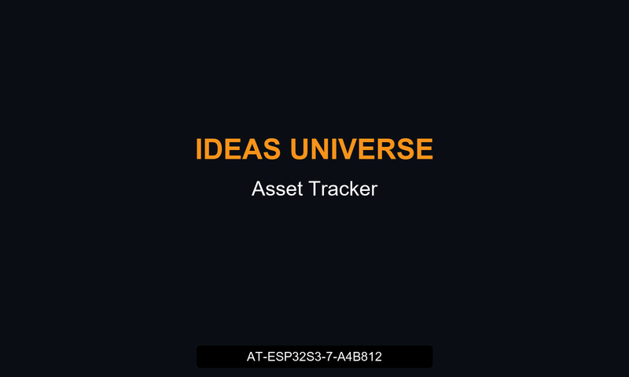 <em>Figure 1: The boot splash. The Device ID is printed near the bottom.</em>

#### 6.2 Connect to Wi-Fi

1. With no saved network, the **Wi-Fi setup** screen opens by itself and scans for networks. Wait a few seconds.
2. Tap your network in the list (strongest signal first). Networks the device already knows are tagged **(saved)**.
3. Type the Wi-Fi password on the on-screen keyboard and tap **CONNECT**.
4. On success the credentials are stored on the device and the main grid appears.

> **Tip.** If no network list appears or the connection keeps failing, tap **Use Phone Setup**. The unit creates its own temporary hotspot named `Ticker-XXXX`. Join it from your phone and a setup page opens where you pick your network and enter the password.

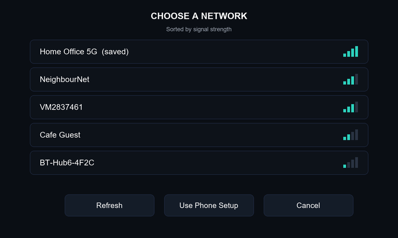 <em>Figure 2: The Wi-Fi setup screen: networks are listed strongest first; saved networks are tagged.</em>

#### 6.3 Set your timezone

1. Tap the **gear** icon at the top right, then the **Wi-Fi** tab.
2. Tap **Timezone**, choose a **region** (Europe, Americas, Middle East and Africa, Asia and Pacific, or similar), then your **city**.
3. Leave **DST** on if your region changes clocks twice a year. For zones that never change the toggle is greyed out.

The clock in the status bar updates immediately. Until you do this the device shows UTC.

#### 6.4 Enter your API keys

Go to **Settings > API & Rate Limits** and enter your Twelve Data key (and CoinGecko key if you have one). See sections 3 and 4.

#### 6.5 Choose your display currency

Tap the **exchange-arrows (FX)** icon in the status bar. At the top of the FX screen, tap the currency chip next to "Display currency" and pick yours. From then on every price shows in that currency, with the original underneath.

#### 6.6 Build your watchlist

Go to **Settings > Watchlist > Add Symbol**, choose **Crypto** or **Equity**, type a ticker or name, wait for results, and tap the right one. See section 12 for the full walkthrough. New symbols may show a placeholder for a few seconds until their first price arrives.

---

## Part Two: Screen-by-Screen Guide

This part describes every screen the device can show, what each element means, and how to get to it. Tapping is the main interaction; **press and hold** (about half a second) and **swipe** are used in a few places and are called out where they apply.

> **Tip.** If a tap or long-press on a grid card feels unreliable, aim for the **chart area** of the card rather than the text above it. On this particular touch panel the chart area is the most consistent target.

> **About the screen pictures.** The pictures in this manual are **illustrations** drawn to match the real screen layout, colours and wording. Your own unit may differ in small details such as spacing, values and symbols.

### 7. Navigation map

| Where you are | How to reach it | How to leave |
| --- | --- | --- |
| Main grid | The home screen. Appears after boot. | Not applicable |
| Detail screen | Tap a card. | Back control at the top |
| Chart style popup | Press and hold a card. | Tap outside the popup |
| Alert popup | Tap a card that has a triggered alert. | Tap Acknowledge |
| FX screen | FX icon in the status bar. | < Back |
| Currency converter | Calculator icon in the status bar. | < Back |
| World clocks | Clock icon in the status bar. | < Back |
| Portfolio | Bar-chart icon in the status bar. | < Back |
| Miner screen | Pickaxe icon in the status bar (or automatically in quiet hours). | Touch anywhere |
| Settings | Gear icon in the status bar. | < Back or Close |
| Screensaver | Automatically at the start of quiet hours. | Touch anywhere |

### 8. The status bar

The strip across the top of every main screen. From left to right:

| Item | What it shows |
| --- | --- |
| Wi-Fi signal bars | Four bars, lit according to signal strength. At least one bar stays lit while connected, so "weak but connected" is distinct from "disconnected" (all bars dim). |
| Status text | Wi-Fi state, internet reachability, and the current time. Wi-Fi and internet are deliberately separate: you can be joined to your router while the internet is down. Extra segments can appear after a divider: exchange status (for example "NASDAQ pre-market", "NYSE closed", "LSE closed"), and the Crypto Fear and Greed reading (for example "F&G: 42 (Fear)"). |
| Calculator icon | Opens the currency converter. |
| Exchange-arrows icon | Opens the FX rates screen. |
| Clock icon | Opens the world clocks. |
| Bar-chart icon | Opens the portfolio screen. |
| Pickaxe icon | Opens the Bitcoin Miner screen on demand. |
| Bell (amber) | Appears only when at least one price alert has triggered and is waiting to be acknowledged. |
| Download arrow (teal) | Appears only when a newer firmware version is available. It is a notification, not a button. |
| Gear icon | Opens Settings. |

### 9. The main grid

The home screen. Each symbol you track gets a card; eight cards fit on a page (four across, two down).

#### 9.1 Anatomy of a card

| On the card | What it means |
| --- | --- |
| Symbol and type badge | The ticker (BTC, AAPL, EUR/USD) with a small badge: **crypto**, **equity**, or **forex**. Pinned currency pairs also show two country flags. |
| Large price | The price in **your display currency**. |
| Smaller price line | The price in the asset's **native currency** (for example USD for BTC). Hidden when it would be the same as your display currency. |
| Change % | The 24-hour change, green when up and red when down. The same colour is used for the chart. |
| Chart | Recent price history in the chosen style (section 9.3). |
| "Xm ago" label | Shown on stale cards: how long since the last successful update. |

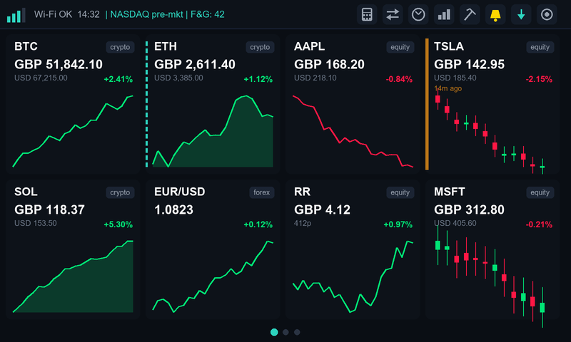 <em>Figure 3: The main grid. BTC and SOL: normal; ETH: alert triggered (dashed teal edge); AAPL: falling; TSLA: stale (amber edge, age shown); EUR/USD: pinned currency pair; RR: London share with pence shown.</em>

#### 9.2 Card states

| What you see | Meaning |
| --- | --- |
| Normal card | Fresh data. Nothing special to do. |
| Amber edge | **Stale:** the last update was a while ago (a temporary network or data-source problem). The last known price is still shown. |
| Red edge or error text | **Error:** the data source returned an error for this symbol (for example a missing key or an unsupported exchange). |
| Placeholder values | **Waiting:** the symbol has been added but its first price has not arrived yet. |
| Dashed teal edge | **Alert triggered:** a price alert on this symbol has fired. Tap the card to see and acknowledge it. |
| Brief colour flash | The price just changed. Flashes are short and only occur on real changes. |

#### 9.3 Chart styles

| Style | Description |
| --- | --- |
| Sparkline | A simple line of recent prices. |
| Area fill | The same line with a soft fade-out fill beneath it. |
| Candlestick | Open/high/low/close candles. Green bodies rose, red bodies fell. |
| Heikin-Ashi | A smoothed candlestick variant that makes trends easier to read by averaging each candle with the previous one. |

Set a **global default** in Settings > Display > Chart Style. Override it for one symbol by **pressing and holding its card**: a popup lists the four styles (the active one highlighted) plus **Use global default**. Tap outside the popup to dismiss it without changing anything.

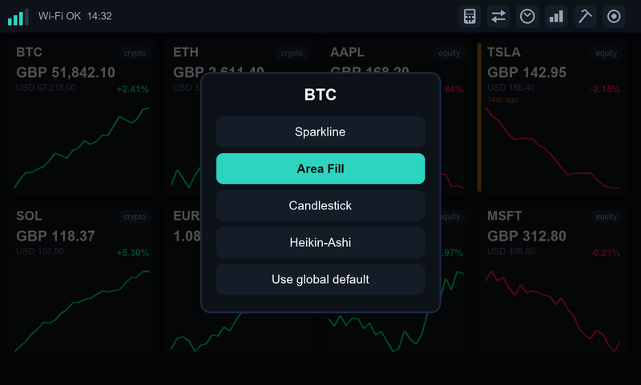 <em>Figure 4: Press and hold a card to choose its chart style. The active style is highlighted.</em>

#### 9.4 Paging

- With more than eight symbols the grid splits into pages. **Swipe left or right** to change page.
- Pages also **rotate automatically** (default every 30 seconds; adjustable from 10 to 300 seconds). A manual swipe resets the timer.
- A row of **dots** below the grid shows which page you are on. The dots are indicators only; they are not tappable and are hidden when there is a single page.

#### 9.5 Heatmap layout

In Settings > Display, **Watchlist Layout** can be switched from **Cards** to **Heatmap**. Each tile becomes a solid block of colour, green for up and red for down, with deeper intensity for bigger moves (the scale tops out around 3%). Near-flat symbols stay a neutral dark colour. Tiles show only the symbol, price and change; charts and secondary prices are hidden. Paging, tap and long-press all still work.

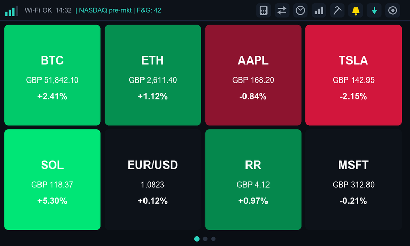 <em>Figure 5: Heatmap layout: colour intensity follows the size of the 24-hour move.</em>

> **Good to know.** Large solid colour areas look different depending on your viewing angle on this type of display. Seen dead-on, greens can look slightly cyan; from a normal desk angle they look right. This is a property of the screen panel, not a fault.

### 10. The detail screen

**Open it** by tapping any card. It shows a full-width candlestick chart with extra context. The chart on this screen is always candlestick regardless of your grid chart-style setting.

| On screen | What it means |
| --- | --- |
| Timeframe tabs | **1H, 1D, 1W, 1M, 3M, 6M, 1Y** for stocks and crypto. Tap a tab to load that range; the previous chart stays visible while the new one loads. Recently loaded ranges are cached for a few minutes (1D) or half an hour (longer ranges) so flicking between tabs is quick. |
| Candles | Each candle is one period of the chosen timeframe (for example 30 minutes on 1D crypto, weekly on 6M/1Y). |
| Yellow moving-average line | A simple moving average of closing prices. It starts partway along the chart because it needs enough earlier candles to calculate; this is normal. The period is set in Settings > Display (default 20). |
| RSI button and panel | Toggles an RSI (momentum) panel under the chart: a 0 to 100 scale with reference lines at 30 (oversold) and 70 (overbought). Needs a minimum amount of data; otherwise it says "Insufficient data for RSI". |
| HA button | Toggles Heikin-Ashi smoothing on the candles. Indicators are always calculated from the real prices, not the smoothed ones. |
| Change stats | Previous close and today's open, side by side (stocks). |

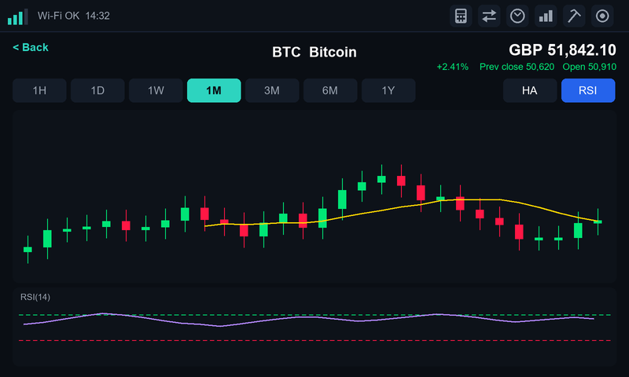 <em>Figure 6: The detail screen: timeframe tabs, candles with the yellow moving average, and the RSI panel.</em>

> **Good to know.** For crypto, true 1-hour data is not available from the free data source, so the **1H** tab reuses the 30-minute candles also shown on 1D. It is labelled as an approximation internally; treat it as "recent hours".

#### Currency pair detail

Tapping a pinned currency pair opens a simpler version: a **line chart of daily rates** with tabs **1D, 1W, 1M, 3M, 6M**, the current rate, the change and the five-day range. There is no moving average or RSI, because the source publishes one rate per day and has no intraday data.

### 11. The FX screen

**Open it** with the exchange-arrows icon in the status bar.

| On screen | What it means |
| --- | --- |
| "Display currency" chip | The one place you change your display currency. Tap it to open a scrollable list of all 30 currencies with flags and full names. The choice applies everywhere immediately. |
| Rate table | One row per tracked pair: **Pair** (with flags), **Rate**, **24h change** (green or red with an arrow), and **5d range** (high and low over the last five business days). |
| "+" button | Adds a pair. Pick the **base** currency first, then the **quote** currency. New pairs appear at the bottom. |
| Press and hold a row | Offers to **pin** the pair to the main grid (or **unpin** if already pinned). |

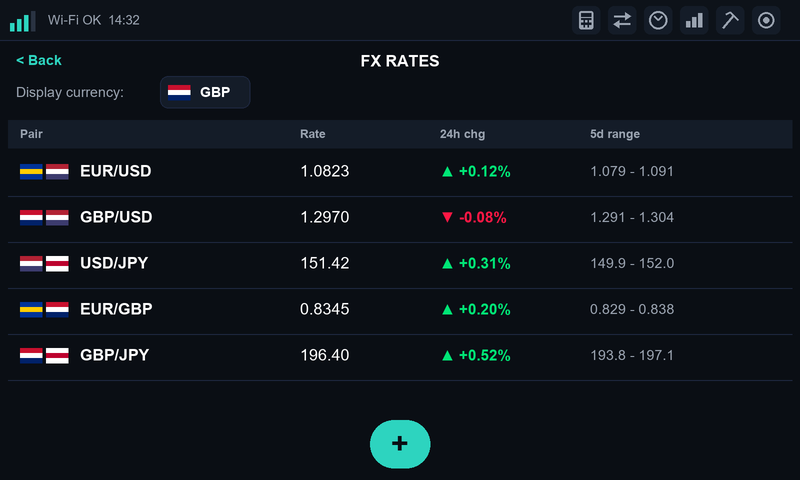 <em>Figure 7: The FX screen: display-currency chip, rate table and the add button.</em>

> **Good to know.** Currency rates are the European Central Bank's daily reference rates. They change once per business day, not tick by tick, so "24h change" compares today with the previous business day and the range is a five-day window, not an intraday high/low. The device checks twice a day.

Five pairs are tracked by default on a fresh device: EUR/USD, GBP/USD, USD/JPY, EUR/GBP and GBP/JPY. Remove or add as you wish; the limit is 32.

### 12. Managing your watchlist

#### 12.1 Adding a symbol

1. Go to **Settings > Watchlist** and tap **Add Symbol**.
2. Choose **Crypto** or **Equity** at the top of the dialog.
3. Type a ticker or name (for example "bitcoin", "AAPL", "Rolls") and wait for the results.
4. Tap the correct result. For equities, check the **exchange** shown. Many tickers exist on several markets.

Messages you may see: "Searching...", "No results found", "Already in watchlist". Duplicates are detected on type plus exchange or id, not the ticker alone, so the cryptocurrency LINK and the NASDAQ stock LINK are correctly treated as different instruments.

#### 12.2 Choosing a data source for a stock

Each stock row in the watchlist shows a small badge: **TD** (Twelve Data) or **YF** (Yahoo Finance). Tap it to switch. Yahoo Finance has broader exchange coverage (it is the way to get London shares on a free setup), but it is an unofficial feed that can change without warning. When you add a stock from the LSE or AIM, Yahoo Finance is suggested automatically; you can override that.

#### 12.3 Removing a symbol

Tap **Remove** on the row and confirm. Removing a symbol does not affect any other symbol's data or timers.

#### 12.4 Limits

| Item | Limit |
| --- | --- |
| Symbols in the watchlist | 64 |
| Currency pairs | 32 |
| World clocks | 8 |
| Saved Wi-Fi networks | 5 |

### 13. Currency converter

**Open it** with the calculator icon. A quick, stand-alone converter between any two of the 30 currencies, using the same daily rates as the FX screen.

- Two currency chips ("Convert from" and "Convert to") open the same flagged picker as the FX screen.
- Tap the amount field and type a number on the numeric keypad.
- The converted value updates immediately.

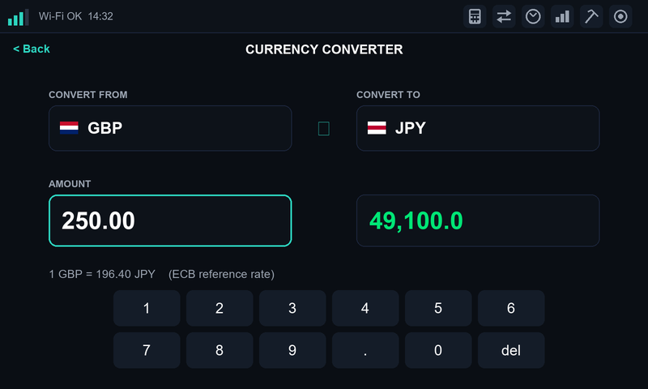 <em>Figure 8: The currency converter.</em>

It works for any pair of the 30 currencies, whether or not you have configured that pair on the FX screen.

### 14. World clocks

**Open it** with the clock icon. Up to eight analogue clock faces, one per city.

| On screen | What it means |
| --- | --- |
| City name | Your chosen city (for example "Tokyo (Japan)"). |
| Analogue face | Hour and minute hands, a thin accent-coloured seconds hand, and tick marks with a stronger marker at 12 o'clock. |
| Digital time | The same time in digits above or below the face. |
| +1 / -1 badge | Shown in a corner when that city's calendar date is different from your own. |
| Add control | Opens a two-step picker: choose a **region**, then a **city**. DST is applied automatically for zones that use it. |

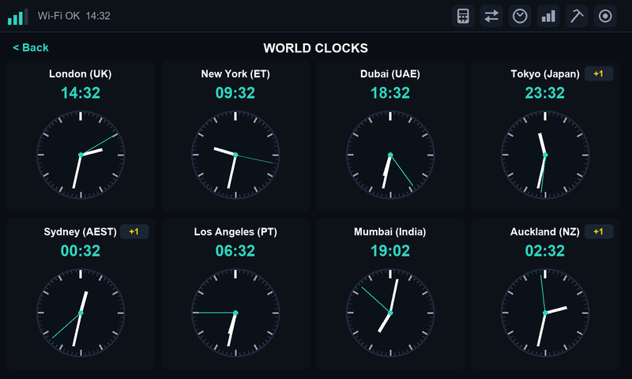 <em>Figure 9: World clocks. The +1 badge means that city is on a different calendar date from yours.</em>

Remove clocks from **Settings > World Clocks**. The hour and minute hands refresh every few seconds; the seconds hand ticks every second.

### 15. Portfolio

**Open it** with the bar-chart icon. Shows the total value of what you hold, in your display currency.

1. Go to **Settings > Portfolio**. Each watchlist symbol has a row.
2. Tap a row and enter the **units held** (coins or shares; decimals are fine). Enter 0 to exclude a symbol.
3. Open the Portfolio screen: a total-value banner at the top, then one row per holding with its value and its percentage of the total.

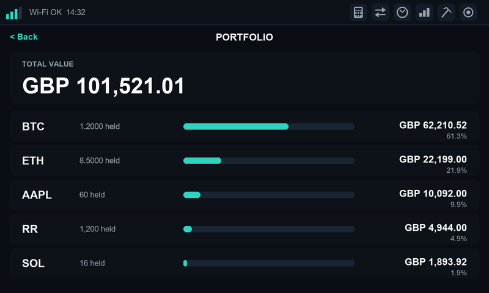 <em>Figure 10: The Portfolio screen: total value and each holding share.</em>

> **Good to know.** Portfolio mode shows **current value and composition only**. It does not track what you paid, so it cannot show profit or loss. A symbol whose latest update failed is still counted using its last known price; only symbols that have never been fetched are left out.

### 16. Price alerts

Get told, on the device, when a price crosses a line you choose.

#### 16.1 Setting an alert

1. Go to **Settings > Alerts**. Every watchlist symbol has a row.
2. Turn the row's **enable** switch on.
3. Choose **Above** or **Below**.
4. Tap the threshold value and enter the price in the symbol's **native currency** (the same scale as the smaller price line on its card), then **Save**.

#### 16.2 When an alert fires

- The amber **bell** appears in the status bar.
- The card gets a **dashed teal edge** and flashes.
- Tap the card: instead of the detail screen you see a popup, for example "BTC crossed above $70,000.00", with an **Acknowledge** button.
- Acknowledging clears the bell and the edge. Normal tapping returns.

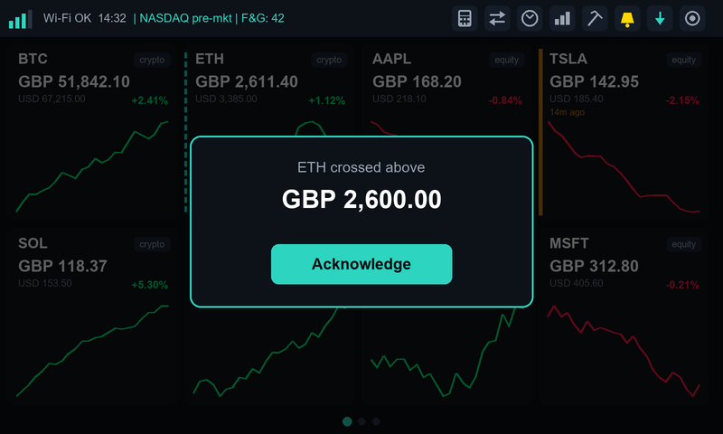 <em>Figure 11: Tapping a card with a triggered alert shows this popup instead of the detail screen.</em>

> **Tip.** An alert fires **once per crossing**, not repeatedly while the price stays beyond the line. It re-arms after you acknowledge it and fires again only on a genuine new crossing. An acknowledged alert stays acknowledged through restarts. If you enable an alert when the price is **already** beyond the threshold, it fires straight away.

> **Good to know.** The Settings > Alerts tab includes a **Piezo Buzzer** option. No buzzer is connected on current hardware, so the switch has no audible effect yet.

### 17. Quiet hours and screensavers

Quiet hours is a daily scheduled window during which the device **pauses all network activity** and shows a screensaver of your choice. It is ideal for overnight.

#### 17.1 Configuring it

In **Settings > Display** set **Quiet Hours Start** and **Quiet Hours End** (24-hour HH:MM; the keypad includes a colon), and pick a **Screensaver** style. If start and end are the same, quiet hours is off.

| Style | What it does |
| --- | --- |
| Blank | Backlight off. Cheapest and darkest. |
| Clock | A large, dim, seven-segment digital clock, updated once a minute. |
| Rain | Matrix-style falling green characters with a white leading character. |
| Stars | A starfield flying outward from the centre of the screen. |
| Miner | The Bitcoin Miner screen (section 18). Mining runs for the whole window. |

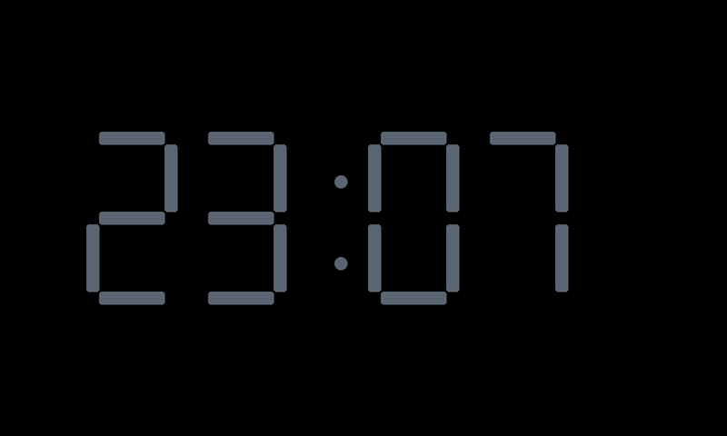 <em>Figure 12: Clock screensaver (dimmed digital clock).</em>

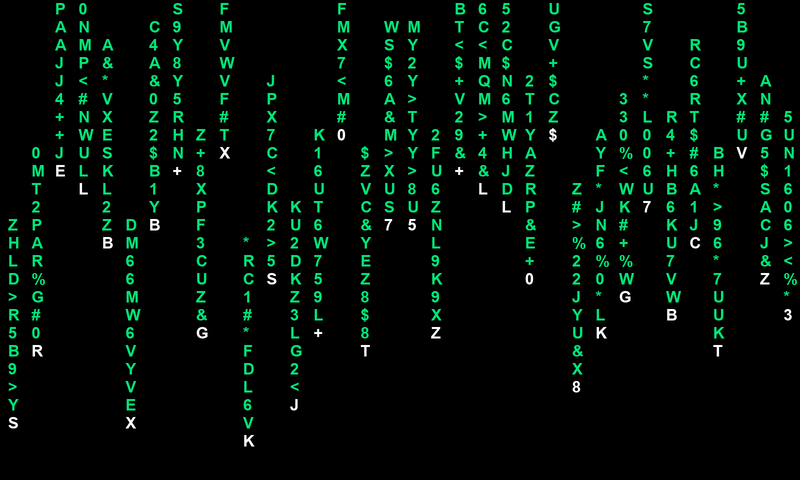 <em>Figure 13: Rain screensaver (Matrix-style falling characters).</em>

#### 17.2 Waking the display

**Touch anywhere** on a screensaver to return to the grid and resume updates immediately. A touch cancels quiet hours **until the next scheduled start**, so it will not re-trigger straight away. This override is deliberately not saved: a power cycle starts fresh.

#### 17.3 Housekeeping reboot

A switch in Display settings, **Housekeeping Reboot**, restarts the device once a day at the start of the quiet-hours window, when nobody is looking. It keeps long-running units fresh. It is greyed out until quiet hours is configured. The device simply comes back up straight into the screensaver if the window is still open.

### 18. The Bitcoin Miner screen

**Open it** with the pickaxe icon, or automatically during quiet hours if you chose the Miner style. **Touch anywhere** to stop and return.

> **Set realistic expectations.** Mining here is a **"for fun, not for profit"** feature. A small microcontroller does roughly 40 thousand hashes per second; the Bitcoin network does hundreds of quintillions per second. The chance of finding a block is vanishingly small. Think of it as a lottery ticket plus a conversation piece, not an income stream.

#### 18.1 Setting it up

In **Settings > Display > Mining Pool**:

| Setting | Meaning |
| --- | --- |
| Pool Host / Pool Port | Defaults: `public-pool.io` and `3333`. Any Stratum V1 pool will work. |
| Mode: Solo | You mine toward **your own Bitcoin address**. Enter it in **Solo BTC Address**. Check it carefully: the pool does not reject an unrecognised address, it simply never sends work, and the screen will sit on "Waiting for job". |
| Mode: Group | All participating units mine toward one shared address built into the firmware; no address entry is needed. |

> **Caution.** In Solo mode with no address entered, the miner refuses to start rather than mine toward nothing. Never use a made-up address: if it is invalid, no rewards could ever reach you.

#### 18.2 What the screen shows

| On screen | What it means |
| --- | --- |
| Title and mode line | "BITCOIN MINER" and "SOLO MODE" or "GROUP MODE". |
| Status text | Connection progress: Connecting, Subscribing, Authorizing, Waiting for job, Mining, or an error message. Once mining, this is replaced by the hashrate. |
| Large hashrate | This unit's current hashrate (H/S, KH/S, MH/S), averaged over a recent window of about 15 to 20 seconds. Expect around 35 to 45 KH/S. |
| Total Hashes | Cumulative hashes since the screen opened, in millions. |
| Best Difficulty | The hardest hash found so far (higher is better). Shown with K/M/G/T suffixes, never scientific notation. |
| Workers | Number of workers the pool currently reports for the whole address. |
| Total Hash Rate | The pool's figure for the whole address, not just this unit. |
| BTC Price | Current Bitcoin price in US dollars. |
| Block Height | Number of the most recent Bitcoin block. |
| Net Hashrate / Net Difficulty | The whole Bitcoin network's hashrate and mining difficulty. |
| Runtime | How long this mining session has been running, in hours and minutes. |
| Valid Blocks Found | Blocks this unit has solved. Realistically stays at 0. |
| Halving Countdown | Blocks remaining until the next Bitcoin reward halving. |
| Fee | A current network fee estimate. |
| Footer | "Touch anywhere to stop", the free memory figure, and "Core1: HW" or "Core1: SW" (see section 31). |

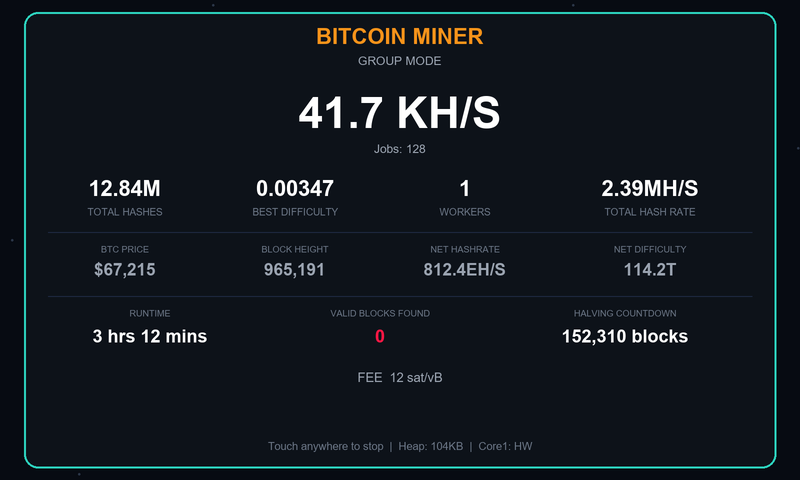 <em>Figure 14: The Bitcoin Miner screen.</em>

> **Good to know.** The **Workers** and **Total Hash Rate** figures come from the pool, which only counts a worker as live when it has recently had a share accepted. At this device's speed, accepted shares can be hours apart, so these two fields often read 0 or "-" even when everything is working. If you use a shared or well-known address, they will reflect other people's miners too. The reliable signs of a healthy unit are the large hashrate, Total Hashes and the Jobs counter climbing.

> **Good to know.** Mining pauses price, FX and update polling while the Miner screen is open, and the screen refreshes its figures about every 10 seconds. The unit gets warm but stays well within safe limits: about 45 °C after hours of mining in a typical room, with no fan needed.

### 19. Settings, tab by tab

Open Settings with the **gear** icon. A sidebar on the left lists the tabs; tap one to see its controls. Tabs are built when first opened, so the first visit to a busy tab may take a moment. **Price polling pauses while Settings is open** to keep things responsive.

#### 19.1 Watchlist

The list of tracked symbols with a data-source badge (TD or YF) and a Remove button on each stock, plus **Add Symbol**. See section 12.

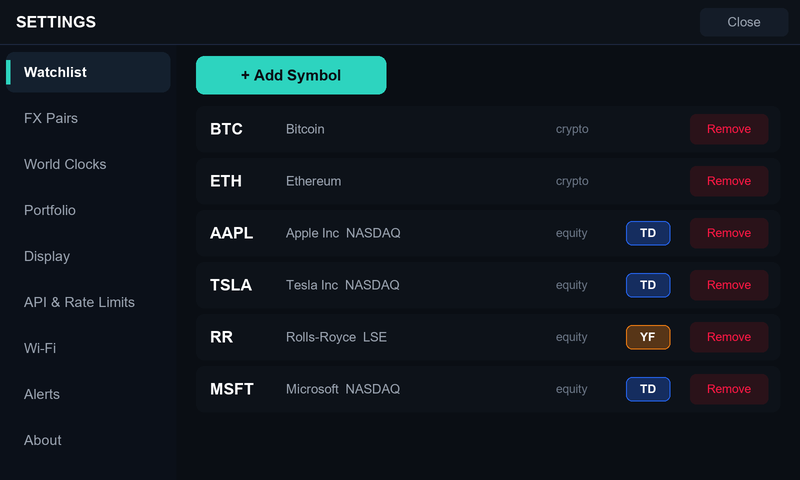 Watchlist, with the TD / YF data-source badges."> <em>Figure 15: Settings > Watchlist, with the TD / YF data-source badges.</em>

#### 19.2 FX Pairs

One row per tracked pair, with flags, a **Pin** toggle (show on the main grid) and **Remove**. Adding pairs is done from the FX screen itself.

#### 19.3 World Clocks

The list of cities with **Remove**. Adding is done from the World Clocks screen.

#### 19.4 Portfolio

One row per symbol to set **units held**. See section 15.

#### 19.5 Display

| Control | What it does |
| --- | --- |
| Brightness | Slider from 10 to 255 (never fully dark, so the screen can always be recovered). Applies live; saved when you release. |
| Chart Style | Global default: Sparkline, Area, Candlestick or Heikin-Ashi. |
| Watchlist Layout | Cards or Heatmap. |
| Page rotate interval | How long each grid page shows, 10 to 300 seconds in 5-second steps. |
| Moving Average period | 5 to 200 (default 20). Applies next time a detail screen opens. |
| RSI period | 5 to 50 (default 14). Applies next time a detail screen opens. |
| Show RSI by default / Show Heikin-Ashi by default | Whether those two detail-screen options start switched on. |
| Theme | Colour presets: **Midnight** (the original), **Terminal**, **Arctic**, **Violet**, **Orchid**. Changing theme rebuilds the grid, so price charts restart from fresh history. |
| Market Holidays | Opens a read-only list of upcoming exchange holidays. |
| Quiet Hours Start / End | The daily window (section 17). |
| Screensaver | Blank, Clock, Rain, Stars, or Miner. |
| Mining Pool | Host, port, Solo/Group mode and Solo BTC address (section 18). |
| Housekeeping Reboot | Daily restart inside the quiet-hours window. |

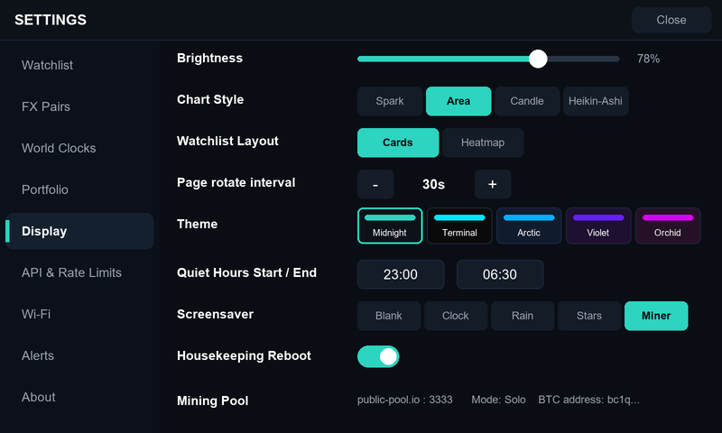 Display."> <em>Figure 16: Settings > Display.</em>

#### 19.6 API & Rate Limits

| Control | What it does |
| --- | --- |
| Twelve Data API Key | Your key. Shows "Not set" until you enter one. Masked input with a show/hide toggle. |
| Daily call budget | Default 800 (free plan). Range 1 to 100,000. Enter your real plan limit. |
| Per-minute rate limit | Default 8 (free plan). Range 1 to 1,000. |
| Derived poll interval | Read-only. The safe per-stock polling pace the device calculated from the two numbers above and your number of stocks, for example "9m 0s per symbol (5 equities, 800 calls/day)". Shows "No equities tracked" if there are no stocks. |
| CoinGecko API Key | Optional Demo key (section 4). |

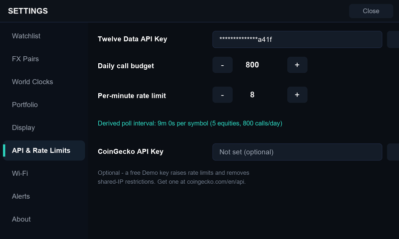 API & Rate Limits."> <em>Figure 17: Settings > API & Rate Limits.</em>

#### 19.7 Wi-Fi

- **Saved networks** (up to 5). The one you are connected to is tagged **Connected**. **Forget** removes a network after a confirmation (forgetting the current one does not disconnect you until the next reconnect).
- **+ Add Network** opens the Wi-Fi setup flow. At 5 networks it is disabled with the message to remove one first. Selecting a network you already saved offers **UPDATE PASSWORD**; it will not create a duplicate. A **Cancel** button is available whenever at least one network is saved.
- **Timezone** and **DST** toggle (section 6.3).

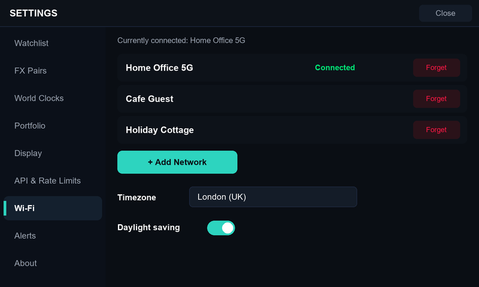 Wi-Fi: saved networks, timezone and DST."> <em>Figure 18: Settings > Wi-Fi: saved networks, timezone and DST.</em>

#### 19.8 Alerts

Per-symbol alert switches, direction and threshold, plus the Piezo Buzzer option (section 16).

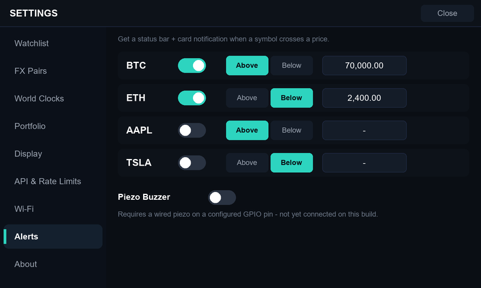 Alerts."> <em>Figure 19: Settings > Alerts.</em>

#### 19.9 About

| Control | What it does |
| --- | --- |
| Running version | The installed firmware version and build date. |
| Device ID | The unit's permanent ID (also shown on the splash). |
| Check for Updates | Looks for a newer version (section 21). |
| Factory Reset (Danger Zone) | After a clear confirmation ("Erase everything?"), wipes Wi-Fi, API keys, settings, watchlist and everything else, then restarts as if brand new. Use before selling or giving the unit away. |

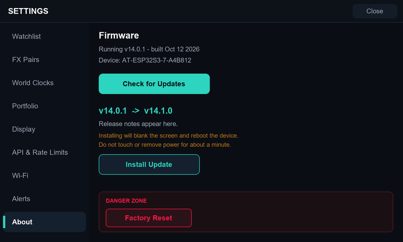 About, showing an available update and the Danger Zone."> <em>Figure 20: Settings > About, showing an available update and the Danger Zone.</em>

### 20. Wi-Fi setup screens

Appear on first boot, when saved networks cannot be reached, and when you choose + Add Network.

| Screen | What it shows |
| --- | --- |
| Scanning | A spinner while nearby networks are found. A Cancel button appears if you already have saved networks. |
| Choose a network | A scrolling list sorted by signal strength; saved networks tagged "(saved)". Buttons: **Refresh**, **Use Phone Setup**, and **Cancel** (when applicable). |
| Enter password / Update password | On-screen keyboard. For a saved network the screen is titled "UPDATE PASSWORD" and the action is **UPDATE**. |
| Connecting / result | Progress, then success or a failure message with options to retry. |
| Cancelling | A brief spinner while the device reconnects to a saved network. |
| Phone setup | The unit hosts a temporary `Ticker-XXXX` network with a setup page; the screen tells you what to do. |

### 21. Software updates

New firmware is published occasionally. **Nothing ever installs itself.**

- The device checks for updates in the background shortly after boot and roughly once a day. If a newer version exists, a teal **download arrow** appears in the status bar.
- Go to **Settings > About**. If an update is available it shows "v14.0.1 -> vX.Y.Z" with the release notes and an **Install Update** button. You can also tap **Check for Updates** manually.
- The About tab states what will happen: the screen will **go blank** and the device will **reboot**. Do not touch it or remove power for about a minute.
- On success it restarts into the new version. On failure the old firmware is untouched and a message says so.

> **While installing.** During installation the screen is deliberately turned off, because the flash write can cause harmless visual glitches on this display. A blank screen for up to a minute is expected. Keep the unit powered.

> **Tip.** If a new version ever fails to start properly, the device automatically goes back to the version that was working and, next time you open Settings > About, tells you which update failed.

---

## Part Two (continued): Everyday Tasks and Troubleshooting

### 22. Quick how-to

| I want to... | Do this |
| --- | --- |
| Change my display currency | FX icon > tap the currency chip at the top > pick a currency. |
| Add a stock | Settings > Watchlist > Add Symbol > Equity > search > tap result. |
| Add a London share | Same, but choose the LSE result; leave the suggested YF (Yahoo Finance) source. |
| Show a currency pair on the main grid | FX screen: press and hold the pair > Pin. Or Settings > FX Pairs > Pin. |
| Change one symbol's chart style | Press and hold its card > choose a style. |
| Make the grid change pages faster or slower | Settings > Display > Page rotate interval. |
| See the total value of my holdings | Settings > Portfolio (enter quantities) > Portfolio icon. |
| Switch off the overnight display | Settings > Display > set Quiet Hours > Screensaver = Blank. |
| Move the unit to another location | Settings > Wi-Fi: add the new network and set the timezone. Saved networks are tried automatically, strongest first. |
| Back up my settings | There is no export. Settings live on the device. Note your watchlist before a Factory Reset. |

### 23. Troubleshooting

| Symptom | Likely cause and fix |
| --- | --- |
| Stock cards show errors or stay empty | No Twelve Data key set, or the key is mistyped. Re-enter it in Settings > API & Rate Limits. London shares need the YF (Yahoo) source on the free plan. |
| Some stocks are slow to update | Normal on the free plan: with many stocks the device spaces calls to stay inside the daily budget. See "Derived poll interval" in API & Rate Limits. |
| Crypto cards go stale or show errors | CoinGecko's free public tier can rate-limit. Add a free Demo key (section 4), especially with multiple devices on one network. |
| Charts start flat after a restart | Chart history is rebuilt at boot and fills in over a few minutes. Cards also reseed from the data providers when the device recovers from a busy period. |
| "Low on memory" or temporary data gaps | The device protects itself by pausing secure connections when free memory is low, then tries again automatically. It normally recovers within a minute or two. |
| Prices show in the wrong currency | Change it on the FX screen's display-currency chip. If the exchange rates have not downloaded yet, the card falls back to the native price until they arrive. |
| Tapping a card is hit-and-miss | Aim for the chart area of the card, not the text above it. |
| Screen colours look slightly off | The panel shifts colour with viewing angle, most visibly on large flat fills such as Heatmap tiles. View from a normal desk angle. |
| Cannot join Wi-Fi | Check it is a 2.4 GHz network. Use Refresh in the scan list, or Use Phone Setup. Try moving the unit closer to the router. |
| Unit will not boot or restarts repeatedly | Suspect the power supply first (section 2). Use a direct 5 V wall adapter and a short, good cable. |
| Miner stuck on "Waiting for job" | In Solo mode, re-check the BTC address character by character. A mistyped address connects but receives no work. |
| Miner: Workers / Total Hash Rate read 0 | Expected at low hashrate (section 18). Look at the large hashrate and Total Hashes instead. |
| Miner: Block Height, Net Hashrate etc. show "-" | They fill in a few seconds after the screen opens, once each data source answers. If one stays blank, wait a few minutes; the device retries. |
| Screen went blank during an update | Expected. Wait up to a minute without touching the unit. |
| An update seems not to have applied | Open Settings > About. If the update failed and the device rolled back, a notice names the version. |
| I want to start over completely | Settings > About > Factory Reset. |

---

## Part Three: Technical Reference

*For readers who want to understand how the Asset Tracker works and why it behaves the way it does. It stays at the level of design and behaviour; it does not describe source code. None of this is needed to use the device.*

### 24. Architecture at a glance

The Asset Tracker is a single-board computer built around an **ESP32-S3** microcontroller (dual-core, 240 MHz) with 16 MB of flash storage and 8 MB of extra memory (PSRAM), driving a 7-inch 800 x 480 display with a capacitive touch controller. The firmware is built on the Arduino framework with the LVGL graphics library for the interface.

| Layer | What it does |
| --- | --- |
| User interface | Draws every screen and handles touch. It never makes network calls itself; it only reads the most recent results. |
| Network task | A background task running on the second processor core. It performs all price, currency, sentiment and update lookups and writes results into shared, lock-protected storage that the interface reads. |
| Storage | Two kinds: small settings (Wi-Fi, keys, brightness, theme) and structured data (watchlist, currency pairs, world clocks). Both are designed to survive power being cut mid-write. |
| Miner (optional) | Its own connection task and two hashing tasks, active only while mining. |

Splitting the interface from the network task means the screen stays responsive even when a data provider is slow or unreachable. A slow request only delays that symbol's next update; it never freezes the display.

### 25. Data sources, polling and rate limits

#### 25.1 How often each source is queried

| Data | Source | Cadence |
| --- | --- | --- |
| Crypto prices | CoinGecko, one batched request for all crypto symbols | Every 60 s with a Demo key; every 90 s without |
| Stock prices | Twelve Data or Yahoo Finance, one symbol at a time | Derived from your budget (see below); never faster than once a minute per symbol |
| Currency rates | Frankfurter (ECB) | Twice a day (the source publishes once per business day); quick retry after a failure |
| Five-day currency history | Frankfurter | Once per calendar day |
| Crypto Fear and Greed | alternative.me | Once a day |
| Detail-screen charts | The same provider as the price | On demand, then cached for a few minutes |
| Bitcoin price, network stats, fees | CoinGecko, blockchain.info, blockstream.info | Every 5 minutes, only while the Miner screen is open |
| Pool statistics | Public Pool | Every 60 seconds, only while mining |
| Firmware update check | GitHub Releases | At boot, then about daily |
| Time | NTP | At boot and periodically |

#### 25.2 The stock polling formula

Free API plans have hard limits, so the device derives a safe pace instead of guessing. For N stocks it takes the **largest** of three numbers:

- the pace that spreads your **daily budget** across N stocks over 24 hours,
- the pace that keeps N stocks inside the **per-minute limit**, and
- a hard floor of **one minute** per symbol (this is a desk display, not a trading terminal).

Example: 5 stocks on the free plan (800 calls/day, 8/minute) settle at roughly 9 minutes per symbol. Crypto is not part of this calculation because CoinGecko is batched and independent. The result is recalculated whenever you change either number or add or remove a stock.

A shared **call gate** also enforces the per-minute limit across every Twelve Data request type at once (live prices, chart history, boot-time catch-up), so a burst in one place cannot quietly use up the allowance of another. A request denied by the gate is simply retried a moment later rather than treated as a failure.

#### 25.3 Why more than one stock source

Twelve Data's free tier does not cover every exchange (London is the common example). Rather than drop those symbols, individual stocks can be fetched from Yahoo Finance instead. The card looks and behaves identically; only the source of the number differs. If a source fails, the card shows an error. It does not silently switch to another provider, because you chose the source and should see when it is not working.

#### 25.4 Data freshness model

Every symbol is in one of four states: **never fetched**, **OK**, **stale** (a past successful value is shown, with its age) or **error**. A single failed poll does not blank the card; the last known value stays visible with a stale marker, which is why portfolio totals and charts remain steady through short outages.

### 26. Currency handling

- Prices are fetched in their **native currency** (USD for crypto and US stocks, pence for London shares) and converted **on the device** using the stored daily rates. No extra network call is made per conversion.
- London prices arrive in **pence**; they are divided by 100 for the conversion maths, while the secondary line still shows pence.
- The card shows your display currency as the large number and the native price underneath, unless they are the same.
- If rates are not available yet, the card shows the native price rather than a wrong converted one, and the chart skips that moment, so it never plots a misleading spike when the rate source is temporarily down.
- Currency symbols (pound, euro, yen) are replaced by ISO codes (GBP, EUR, JPY) because the display font carries only the character ranges the interface needs.

### 27. Storage and resilience

| What | Where | Why |
| --- | --- | --- |
| Wi-Fi networks, API keys, brightness, theme, alert state, quiet hours, timezone, mining settings | Non-volatile settings store | Small values; designed to tolerate sudden power loss. |
| Watchlist, currency pairs, world clocks, display currency, per-symbol options | A small flash file system (one JSON configuration file) | Structured data. Also power-loss tolerant. No SD card is used or needed. |
| Boot splash image | The same flash file system | Too large to embed in the firmware without crowding out update space. |

The flash is split into **two firmware slots** plus the data areas, which is what makes safe updates possible (section 29).

#### 27.1 Protecting itself under memory pressure

Secure internet connections need a large block of contiguous memory for each handshake. After many hours of continuous operation, free memory on small devices can become fragmented into pieces too small for that. Repeated failed handshakes make the fragmentation worse. The firmware defends against that with a **memory-aware circuit breaker**:

- Before every secure request it checks that enough memory, in a large enough block, is available. If not, it skips the request entirely rather than attempting it and failing.
- About once a minute it lets a single probe attempt through regardless, so the device can notice recovery and never gets stuck waiting forever.
- Boot-time chart seeding recognises these device-wide pauses (and the stock rate-limit gate) as temporary and retries patiently, instead of giving up on that symbol.
- Screens are built lazily (Settings tabs only when first opened) and the Settings screen pauses polling while open, which was found to avoid a clash between screen construction and a network handshake.
- Optional **Housekeeping Reboot** during quiet hours gives a clean slate daily if you prefer it.

### 28. Security and privacy

| Topic | How it works |
| --- | --- |
| Where your secrets live | Wi-Fi passwords and API keys are typed on the device and stored only in its own memory. They are never compiled into the firmware, never shared between units, and not sent anywhere except to the service they belong to (for example your Twelve Data key goes to Twelve Data). |
| What leaves the device | Ordinary data requests to the providers listed in section 5: ticker symbols, the pool login if you mine, and your key in the request where the provider requires it. There is no Ideas Universe server and no analytics or telemetry. |
| Encryption | All data requests use HTTPS. For practicality on a small device the firmware does **not verify server certificates**, so it is protected against casual eavesdropping but not against a determined attacker who controls your network. Treat the device accordingly. |
| Mining pool traffic | Stratum connections to the pool are plain, unencrypted TCP (the common standard). Your Bitcoin receive address is public by design; no private keys ever exist on the device. |
| Factory reset | Erases the whole settings store and the configuration file, including Wi-Fi and keys. The boot splash image is kept. |
| Updates | Come only from the public releases repository, are started only by you, and a failed install cannot leave the unit unusable. |

### 29. Updates and rollback

The flash holds two complete firmware images. An update is written to the slot that is **not** running; only after it is fully written and verified does the bootloader point at it. The new version is then on probation: it is marked "pending", and has to boot and run its start-up successfully to confirm itself. If it crashes or reboots before confirming, the bootloader automatically goes back to the previous image. The device then tells you in Settings > About which version failed.

This was tested deliberately by installing builds designed to fail, and the revert worked every time before the feature was signed off.

Releases are published as a firmware file plus a small manifest (version, download address, notes) in a public releases repository. The device reads the manifest, compares version numbers, and offers the update only if it is strictly newer. There is no downgrade path and no automatic install.

### 30. Display, colour and touch

#### 30.1 Why the colours are so vivid

This display's panel type (TN) shifts colour as the viewing angle changes, and the shift is worst on muted, pastel colours where red, green and blue are all partially lit. Fully saturated colours barely shift. So up/down green and red (and accents) are deliberately strong. Themes change only backgrounds, card surfaces, borders and accent; text and the green/red trend colours stay fixed so they stay legible on every theme.

#### 30.2 Touch

The touch controller originally had no way to signal "touched", so software polled it constantly, which slowed everything else. A small hardware change routes its interrupt line to the processor; touch is then handled only when needed. A minor residual effect remains: taps on the chart area of a card register slightly more reliably than on the text above it, most likely a calibration characteristic of the panel, so the guidance is to tap the chart.

#### 30.3 Animation philosophy

Cards ease in, prices flash briefly when they change, and pages glide between each other. Every animation is tied to a genuine change and none runs continuously in the background, because a desk display is meant to be glanced at, and constant motion would be distracting and would use processor time better spent on data. The screensavers (rain, stars) are the one deliberate exception, and are safe precisely because all network activity is paused while they run.

#### 30.4 Fonts and characters

The interface carries a limited character set to save space. That is why you will see plain hyphens in place of fancy dashes and ISO currency codes instead of currency symbols.

### 31. The miner in more detail

#### 31.1 How mining works here

The device connects to a **Stratum V1** mining pool, receives a block-template "job", assembles the block header, and repeatedly computes the double SHA-256 hash of that header with different nonce values, looking for a result whose difficulty meets the pool's target. Qualifying results are submitted as **shares**. A hash meeting the whole network's difficulty would be a valid block; at this device's speed that is astronomically unlikely, but the check is genuinely performed on every hash.

#### 31.2 Solo and Group

- **Solo:** work and rewards are credited to the Bitcoin address you enter. Any reward would pay directly to you.
- **Group:** every participating unit mines toward one shared address fixed in the firmware, with each unit identified by its Device ID. Contribution can be audited from the pool's own per-worker view, and any reward is shared out separately by the group.

#### 31.3 Using both processor cores

Mining runs on both cores. One core uses an efficient software implementation of SHA-256 that reuses precomputed state for the constant first half of the header. The other core uses the chip's **hardware SHA accelerator**. Only one core touches that single shared hardware block, which avoids the contention that earlier experiments showed cancelling any gain from using it on both cores. On start-up the hardware path is checked against a known test value; if the check fails the core silently falls back to software, and the footer reads "Core1: SW" instead of "Core1: HW". Typical combined performance is around 40 KH/s (hardware path) or 35 KH/s (software only), a roughly threefold improvement over the first naive version.

> **Good to know.** The user interface task is given a higher scheduling priority than the hashing task that shares its core. That keeps the screen free of visual tearing and responsive to touch, at the cost of a little hashrate. It was tuned to the best compromise found.

#### 31.4 Safety checks

- A built-in self-test of the header-assembly and hashing pipeline runs before any connection, against a fixed known answer.
- Pool jobs are validated: every field must be exactly the expected length and duplicated merkle branches (a sign of a corrupted message) cause the job to be rejected.
- Incoming protocol lines are read with a fixed-size limit; an over-long line is treated as a corrupted stream and the connection is reset cleanly.
- Hashing pauses automatically whenever the pool connection is down, rather than burning power on work that cannot be submitted.
- A periodic keepalive message is sent to the pool, and the miner reconnects automatically if the connection drops.

#### 31.5 Heat

Mining loads both cores continuously, which warms the chip. Measurements on fanless units showed a plateau around 45 °C after about two hours in a normal room (roughly 20 °C above ambient), well inside the chip's rated limits. If your enclosure is unusually confined or your room very warm, test first with a temperature check before leaving a unit mining unattended.

#### 31.6 Why some statistics are missing or "0"

Network statistics are fetched from sources reachable over **IPv4**, because the device's Wi-Fi stack has no IPv6 support. One popular source turned out to be unreachable over IPv4, which is why the miner uses blockchain.info and blockstream.info. The pool's worker counts depend on accepted-share timing as explained in section 18.

### 32. Limits and known limitations

| Area | Limitation |
| --- | --- |
| Wi-Fi | 2.4 GHz only. No IPv6. Designed for ordinary home and office networks with a password; enterprise (802.1X) sign-in is not provided. |
| Stocks (free tier) | Twelve Data free plan excludes some exchanges (e.g. London); use Yahoo Finance for those. Yahoo is unofficial and can change. |
| Currency data | Daily ECB reference rates only; no intraday FX, no bid/ask. 30 currencies. |
| Detail charts | FX pairs have no 1H or 1Y view. Crypto 1H reuses 30-minute data. |
| Portfolio | Value and composition only. No cost basis, no profit/loss. |
| Alerts | One above/below threshold per symbol. No percentage-move or multi-condition alerts. No audible buzzer yet. |
| Screen | Viewing-angle colour shift on large solid areas (Heatmap). Touch is most reliable on card chart areas. |
| Mining | Hobby-level hashrate; Workers and Total Hash Rate depend on pool share timing. |
| Not available | News headlines, prediction-market odds, stock Fear and Greed (no official public source), multiple languages (English only), data export or backup. |

---

## Appendices

### Appendix A: Glossary

| Term | Meaning |
| --- | --- |
| Candlestick | A chart mark showing open, high, low and close for one time period. |
| Heikin-Ashi | A smoothed candlestick variant calculated from averages of the real candles. |
| SMA / Moving average | The average of the last N closing prices; smooths out short-term noise. |
| RSI | Relative Strength Index, a 0 to 100 momentum measure. Above 70 is often read as overbought and below 30 as oversold. |
| Native currency | The currency an asset is actually priced in at its source. |
| Display currency | The currency you chose to see prices in. |
| Stale | Showing the last known value because a recent update did not succeed. |
| API key | A private code identifying your account to a data provider. |
| Rate limit | The number of requests a provider allows in a given time. |
| OTA | Over-the-air: updating firmware through Wi-Fi instead of a cable. |
| Rollback | Automatic return to the previous firmware if a new one fails to start. |
| Stratum | The standard protocol miners use to talk to mining pools. |
| Share | A proof-of-work result easier than a full block, submitted to a pool to show you are contributing. |
| Hashrate | How many hash calculations per second; H/S, KH/S (thousand), MH/S (million). |
| Difficulty | How hard a hash result is to find; higher means rarer. |
| Halving | The scheduled event, every 210,000 blocks, when the Bitcoin mining reward is cut in half. |
| Device ID | The unit's permanent identifier derived from its hardware address. |
| Quiet hours | The scheduled daily window with network activity paused and a screensaver shown. |

### Appendix B: Specifications

| Item | Value |
| --- | --- |
| Board | ESP32-S3 |
| Processor | ESP32-S3, dual-core, 240 MHz |
| Memory | 16 MB flash, 8 MB PSRAM |
| Display | 7-inch, 800 x 480, RGB-parallel TN panel |
| Touch | GT911 capacitive controller |
| Wi-Fi | 2.4 GHz 802.11 b/g/n |
| Power | 5 V via USB; use a good-quality dedicated adapter |
| Firmware slots | Two 2 MB application slots plus a data partition |
| Watchlist capacity | 64 symbols, 32 currency pairs, 8 world clocks, 5 saved Wi-Fi networks |
| Themes | Midnight, Terminal, Arctic, Violet, Orchid |
| Firmware version covered | 14.0.1 |

### Appendix C: Version history

| Version | Highlights |
| --- | --- |
| v14.0.1 | Device ID shown on the boot splash; Thermal Test option removed from Settings. |
| v14.0.0 | Baseline release consolidating versions 10 to 13. |
| v13 | Complete Bitcoin mining feature, Solo and Group modes, hardware-accelerated hashing, Miner screen with Global Stats. |
| v12 | Heatmap layout, Portfolio mode, Crypto Fear and Greed, Factory Reset, Housekeeping Reboot. |
| v11 | Heikin-Ashi, exchange sessions, world clocks, quiet hours and screensavers, seven detail timeframes. |
| v10 | Currency converter, country flags, market holidays, themes. |
| v9 | Animation polish and price alerts. |
| v8 | Over-the-air updates with automatic rollback. |
| v7 | Multiple saved Wi-Fi networks, signal indicator, boot splash. |
| v6 | Yahoo Finance source, detail-screen indicators, timezone settings, tabbed Settings. |
| v5 | FX screen, display-currency conversion, pinned currency pairs. |
| v4 | Paging, display settings, chart styles, rate-limit configuration. |
| v3 | Settings screen and symbol search. |
| v2 | Live prices and on-device Wi-Fi setup. |
| v1 | Display, touch and the first grid. |

*Ideas Universe Asset Tracker. Third-party services named in this manual are trademarks of their respective owners and are not affiliated with this product. Nothing displayed by this device is financial advice.*

